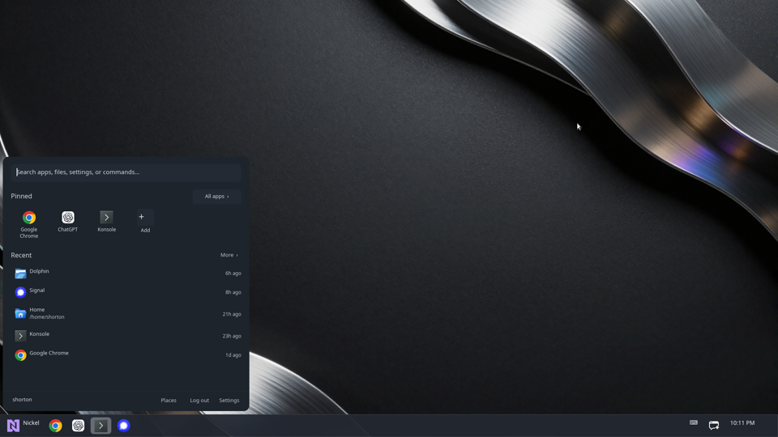

# steven horton

## what i'm working on

| ✨ [Twinkle](https://github.com/shortontech/twinkle) | 🪙 [Nickel](https://github.com/shortontech/nickel) |
| --- | --- |
| a native rust ui engine for building responsive, accessible cross-platform software without requiring a browser runtime. it supports declarative Rust and optional JSX/TSX authoring, typed messages, native presentation, and controller navigation. |   a Twinkle-based desktop environment for Windows and Linux, built to make the desktop itself customizable. its TSX-authored shell provides the taskbar or dock, launcher, task switching, system controls, controller navigation, and applications without Electron or a browser. |

### 🥒 [pickle](https://github.com/shortontech/pickle)

pickle generates secure, inspectable go backends from application models and access rules—with no runtime framework dependency.

## why

nickel exists because i couldn't launch fortnite with my controller without ugly full screen ui launchers. windows 8 was hated for a reason. i don't need xmb or full screen styling.

twinkle exists because nickel's ui became useful outside of nickel.

pickle exists because existing security tooling isn't good enough for my use cases and frameworks offer little in terms of security guarantees.
